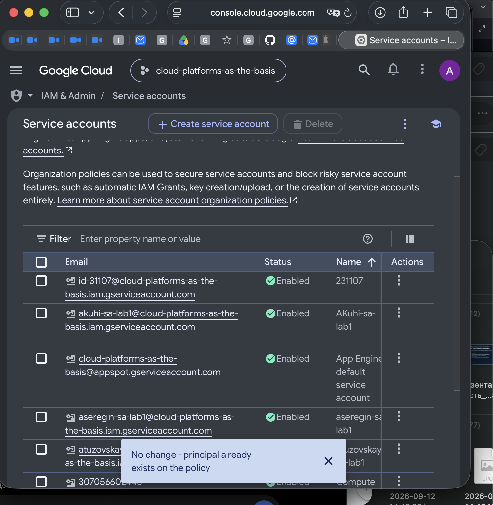
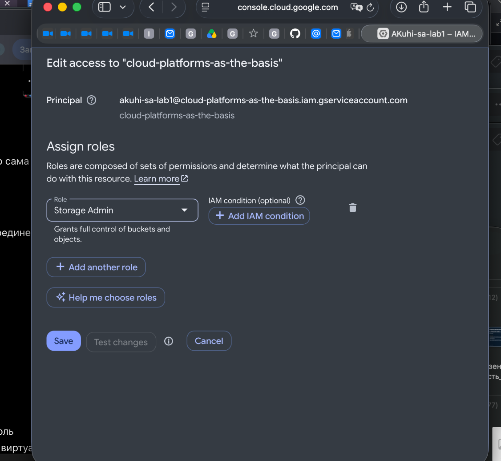
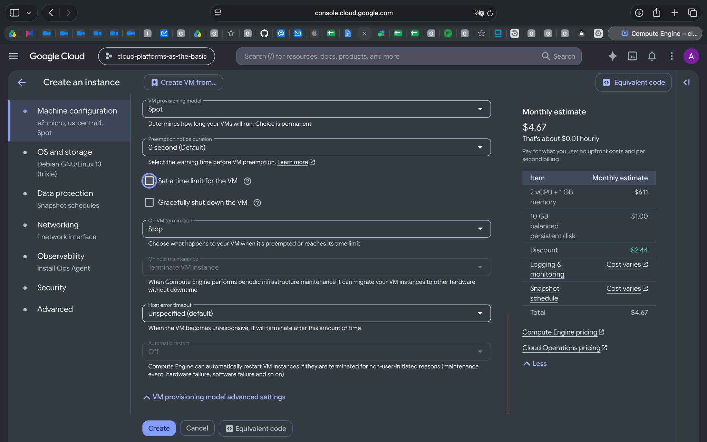
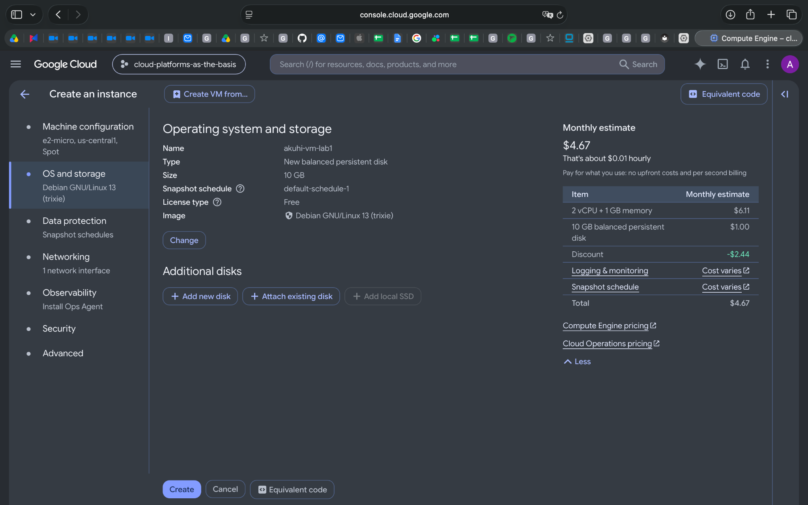
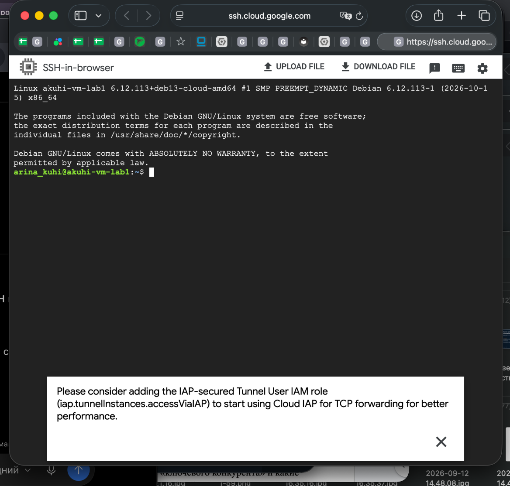
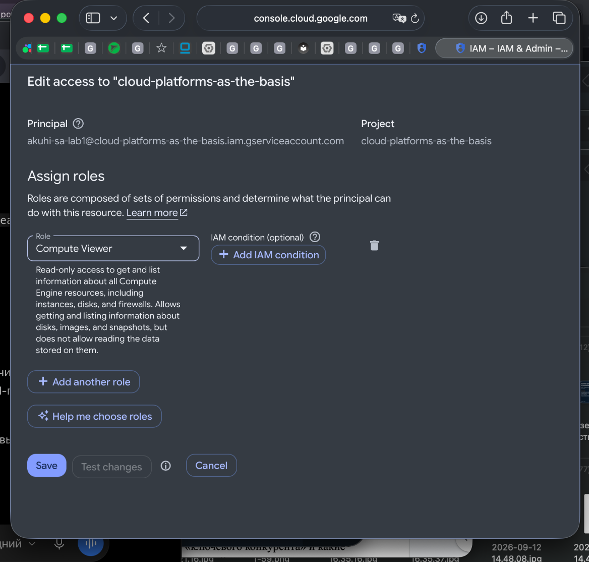
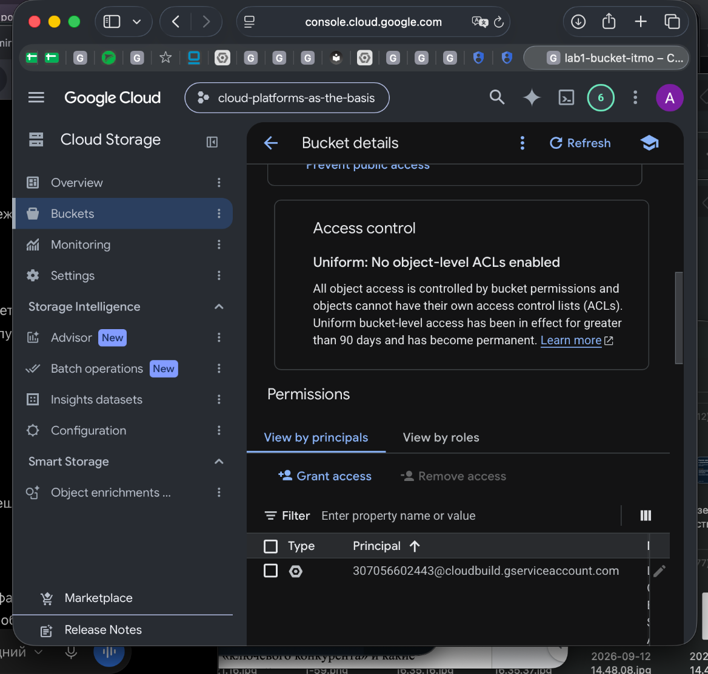
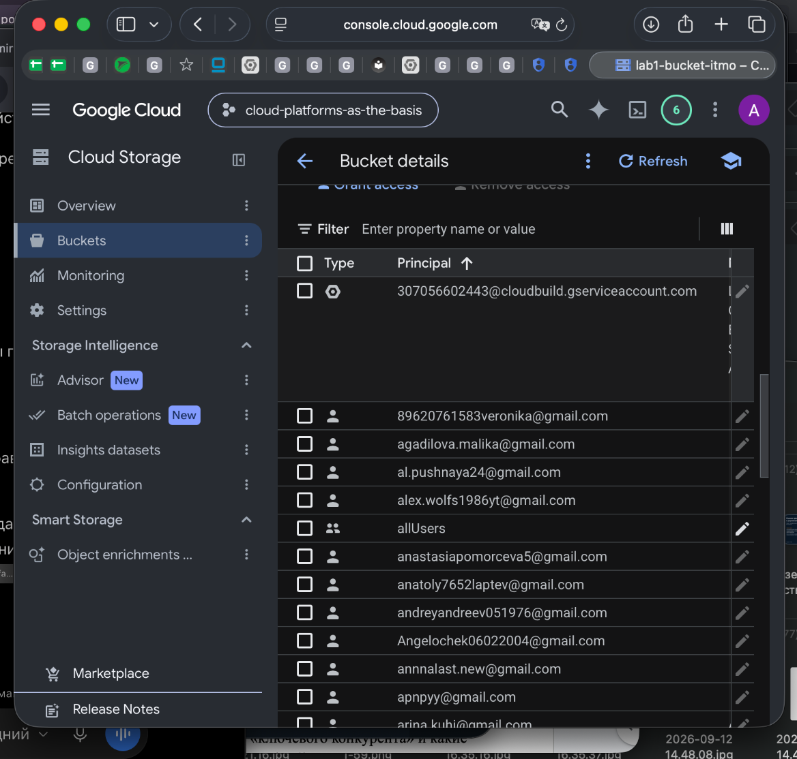

# Лабораторная работа №1. Обзор Google Cloud и исследование основных сервисов

University: [ITMO University](https://itmo.ru/ru/)  
Faculty: [FICT](https://fict.itmo.ru/)  
Course: [Cloud platforms as the basis of technology entrepreneurship](https://ex-itmo-ict-faculty.github.io/cloud-platforms-as-the-basis-of-technology-entrepreneurship/)  
Year: 2026  
Group: не указана  
Author: Арина Кухи  
Lab: Lab1  
Date of create: 03.11.2026  
Date of finished: не защищена

[← К списку работ](../README.md) · [Задание](https://ex-itmo-ict-faculty.github.io/cloud-platforms-as-the-basis-of-technology-entrepreneurship/education/labs2023-2024/lab1/lab1/)

## Цель работы

Ознакомиться с Google Cloud, создать сервисный аккаунт с IAM-ролью, запустить виртуальную машину Compute Engine и исследовать, как права доступа влияют на получение файлов из Cloud Storage.

## Использованные ресурсы

| Параметр | Значение |
| --- | --- |
| Проект Google Cloud | `cloud-platforms-as-the-basis` |
| Сервисный аккаунт | `akuhi-sa-lab1@cloud-platforms-as-the-basis.iam.gserviceaccount.com` |
| Виртуальная машина | `akuhi-vm-lab1` |
| Machine type | `e2-micro` |
| Provisioning model | `Spot` |
| Регион / зона | `us-central1` / `us-central1-a` |
| ОС | Debian GNU/Linux 13 (trixie) |
| Размер загрузочного диска | 10 GB |
| Учебный бакет | `gs://lab1-bucket-itmo` |

## Ход работы

### 1. Создание Service Account

В разделе **IAM & Admin → Service Accounts** создан аккаунт `AKuhi-sa-lab1` (ID: `akuhi-sa-lab1`). На уровне учебного проекта ему назначена роль **Storage Admin** (`roles/storage.admin`).





### 2. Создание виртуальной машины

В разделе **Compute Engine → VM instances** создана виртуальная машина `akuhi-vm-lab1` с типом `e2-micro`, моделью Spot, в зоне `us-central1-a`. Выбран образ Debian GNU/Linux 13 и загрузочный диск размером 10 GB. К виртуальной машине привязан созданный сервисный аккаунт, что впоследствии подтверждено командой `gcloud auth list`.





### 3. Подключение по SSH и загрузка файлов из Cloud Storage

Подключение к VM выполнено через **SSH-in-browser**.



Проверен активный аккаунт:

```bash
gcloud auth list
```

Получен результат:

```text
ACTIVE  ACCOUNT
*       akuhi-sa-lab1@cloud-platforms-as-the-basis.iam.gserviceaccount.com
```

Найден учебный бакет:

```bash
gcloud storage buckets list
gcloud storage ls gs://lab1-bucket-itmo/
```

Список объектов:

```text
gs://lab1-bucket-itmo/pic1.jpg
gs://lab1-bucket-itmo/pic2.jpg
gs://lab1-bucket-itmo/pic3.jpeg
```

Выполнено скачивание файлов в локальную директорию виртуальной машины:

```bash
mkdir -p ~/lab1-files
gcloud storage cp gs://lab1-bucket-itmo/* ~/lab1-files/
ls -lah ~/lab1-files/
```

Вывод подтвердил успешное копирование всех трёх файлов (`Completed files 3/3`):

```text
-rw-rw-r-- 1 arina_kuhi arina_kuhi 228K Nov  3 16:04 pic1.jpg
-rw-rw-r-- 1 arina_kuhi arina_kuhi 487K Nov  3 16:04 pic2.jpg
-rw-rw-r-- 1 arina_kuhi arina_kuhi 858K Nov  3 16:04 pic3.jpeg
```

### 4. Замена роли на Compute Viewer

В **IAM** для `akuhi-sa-lab1` роль **Storage Admin** заменена на **Compute Viewer** (`roles/compute.viewer`). Наличие новой роли подтверждено через интерфейс управления доступом.



### 5. Повторное копирование и анализ прав доступа

После изменения роли из той же VM вновь проверен активный сервисный аккаунт и выполнены команды:

```bash
gcloud auth list
gcloud storage ls gs://lab1-bucket-itmo/
mkdir -p ~/lab1-test
gcloud storage cp gs://lab1-bucket-itmo/pic2.jpg ~/lab1-test/pic2-new.jpg
```

Фактический результат: файл `pic2.jpg` **успешно скопирован повторно**, несмотря на отсутствие роли Storage Admin в отображаемых назначениях IAM:

```text
Copying gs://lab1-bucket-itmo/pic2.jpg to file:///home/arina_kuhi/lab1-test/pic2-new.jpg
Completed files 1/1 | 486.6kiB/486.6kiB
```

При изучении **Cloud Storage → Bucket details → Permissions** обнаружена привязка **`allUsers` → `Storage Object Viewer`**. Такая привязка позволяет читать объекты бакета независимо от наличия роли Storage Admin у конкретного сервисного аккаунта. Поэтому успешная загрузка после смены роли **не означает**, что роль Compute Viewer включает доступ к объектам Cloud Storage. Дополнительно в интерфейсе бакета отображалось, что применяется Uniform bucket-level access.





Роль `Storage Object Viewer` для `allUsers` была установлена при отдельном просмотре карточки разрешения в интерфейсе Google Cloud. IAM-политика общего учебного бакета не изменялась.

### 6. Очистка ресурсов

По завершении работы виртуальная машина `akuhi-vm-lab1` удалена через интерфейс Compute Engine. Бакет `lab1-bucket-itmo` и его содержимое не затрагивались. Удаление сервисного аккаунта в ходе этой работы **не подтверждено**; перед окончательной сдачей необходимо проверить его наличие и удалить, если аккаунт больше не нужен.

## Выводы

В ходе работы создан сервисный аккаунт, исследованы роли IAM, запущена Spot VM `e2-micro` и выполнено копирование трёх объектов Cloud Storage на локальный диск VM. После изменения роли с Storage Admin на Compute Viewer повторное скачивание файлов продолжило работать. Это объясняется наличием в IAM-политике бакета доступа на чтение для `allUsers` через роль Storage Object Viewer. Следовательно, эффективные разрешения следует анализировать на всех применимых уровнях — проект и конкретный ресурс. Виртуальная машина после выполнения эксперимента удалена.
