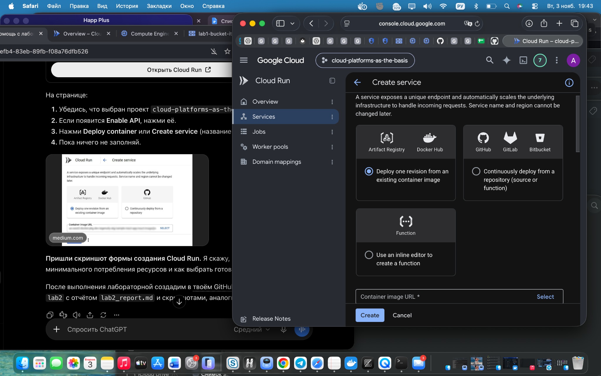
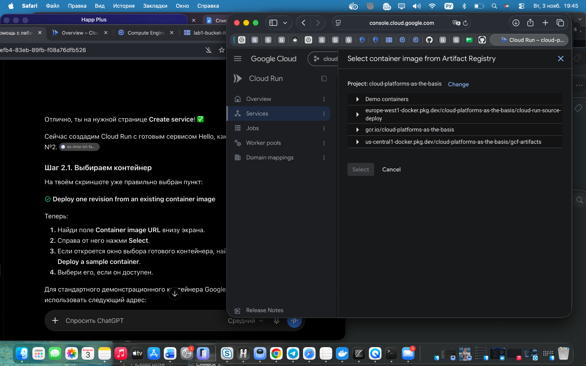
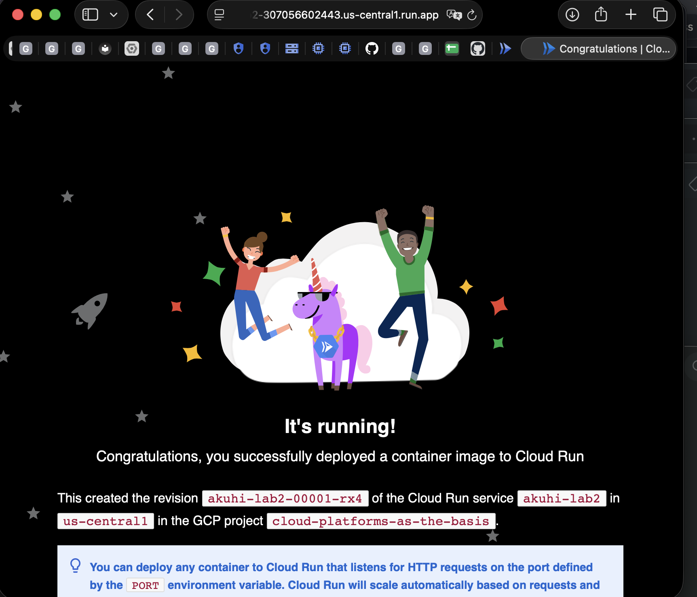
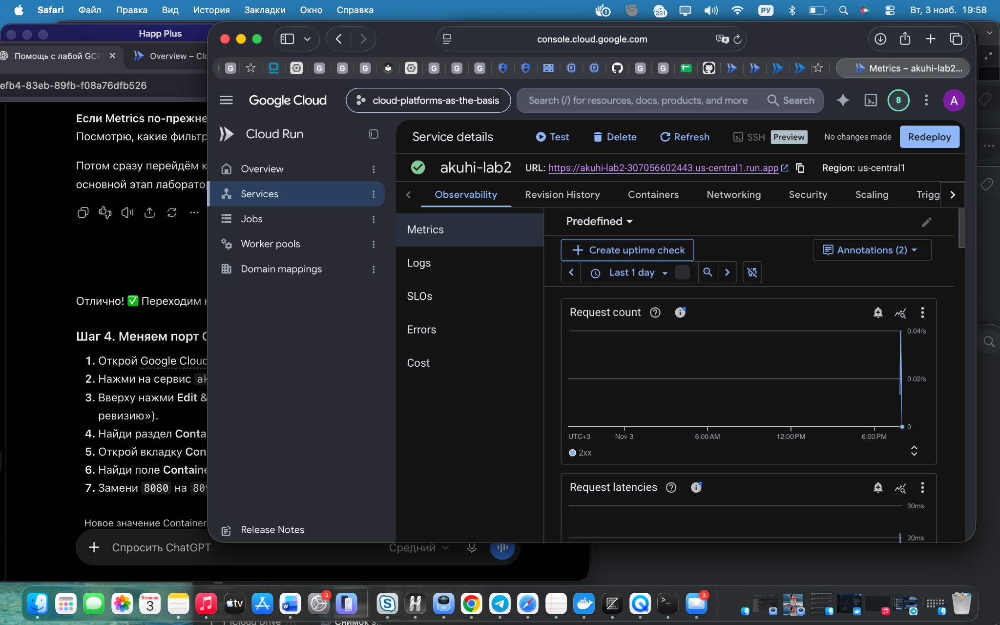
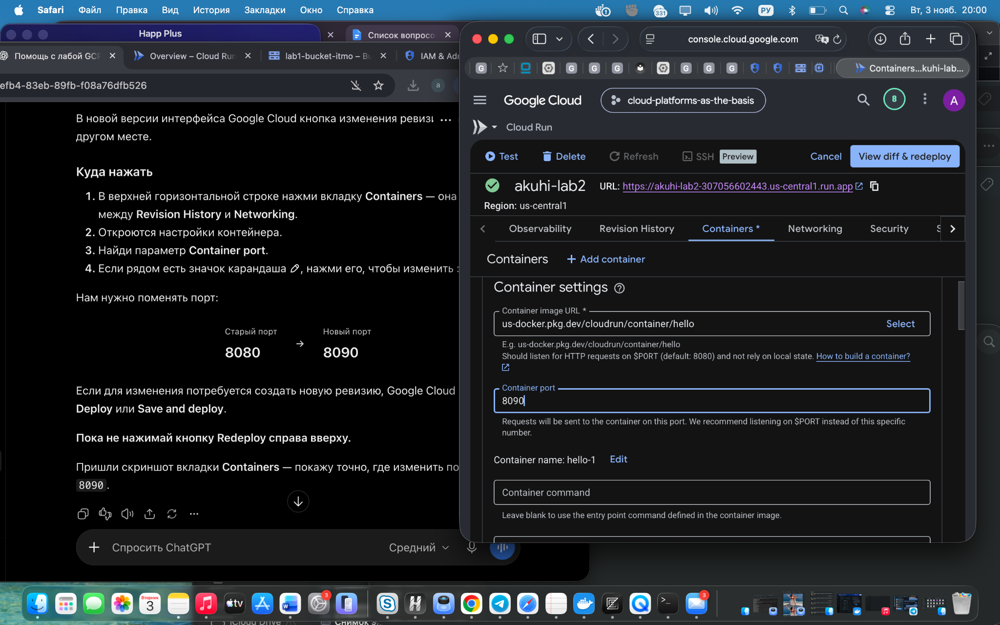
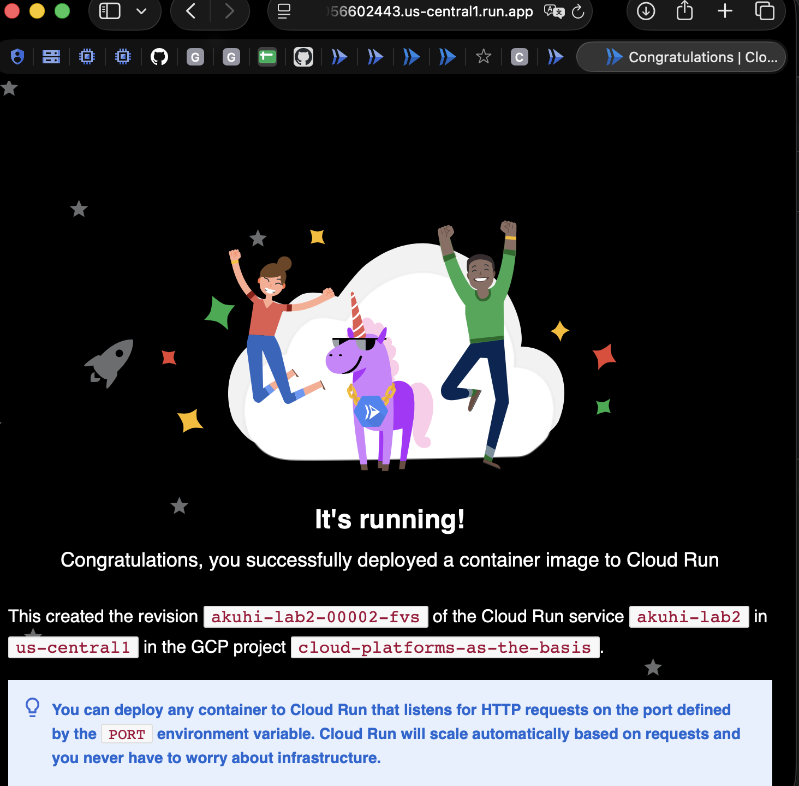
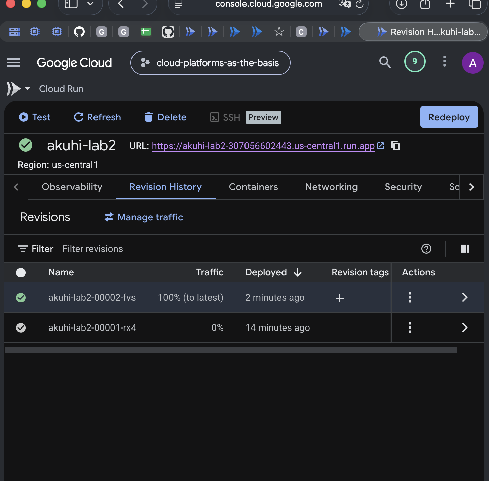
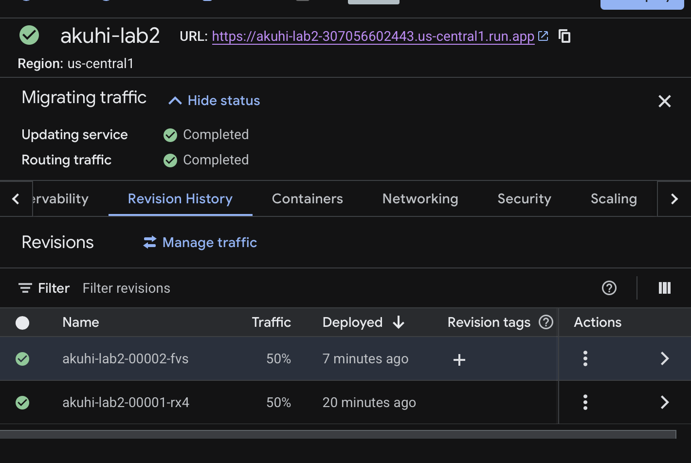

# Лабораторная работа №2 — Исследование Cloud Run

| Поле | Значение |
|---|---|
| University | [ITMO University](https://itmo.ru/ru/) |
| Faculty | [FICT](https://fict.itmo.ru/) |
| Course | [Cloud platforms as the basis of technology entrepreneurship](https://ex-itmo-ict-faculty.github.io/cloud-platforms-as-the-basis-of-technology-entrepreneurship/) |
| Year | 2026 |
| Group | U4225 |
| Author | Арина Кухи (Arina Kuhi) |
| Lab | Lab2 |
| Date of create | 03.11.2026 |
| Date of finished (защита) | Не защищена |

## Цель работы

Познакомиться с Cloud Run в Google Cloud: развернуть контейнерное приложение, протестировать доступ по HTTPS, изучить журналы и метрики, изменить конфигурацию контейнера и распределить трафик между ревизиями.

**Задание:** [Лабораторная работа №2 ИТМО](https://ex-itmo-ict-faculty.github.io/cloud-platforms-as-the-basis-of-technology-entrepreneurship/education/labs2023-2024/lab2/lab2/).

## Ход работы

### 1. Создание сервиса Cloud Run

В Google Cloud Console проекта `cloud-platforms-as-the-basis` был открыт раздел **Cloud Run → Services → Create service**. Выбран вариант развёртывания готового контейнерного образа (**Deploy one revision from an existing container image**).

Использованы следующие параметры:

| Параметр | Значение |
|---|---|
| Project ID | `cloud-platforms-as-the-basis` |
| Service name | `akuhi-lab2` |
| Region | `us-central1` |
| Container image | `us-docker.pkg.dev/cloudrun/container/hello` |
| Initial container port | `8080` |
| Authentication | Публичный доступ для тестирования |
| Minimum instances | `0` |
| Initial maximum instances | `1` |





### 2. Проверка работы сервиса

После создания получен HTTPS-адрес сервиса:

`https://akuhi-lab2-307056602443.us-central1.run.app`

При открытии страницы появилось сообщение **“It's running! Congratulations, you successfully deployed a container image to Cloud Run”**, подтверждающее успешное развёртывание приложения.

Первая ревизия: `akuhi-lab2-00001-rx4`.



### 3. Просмотр журналов и метрик

В разделе **Observability** были рассмотрены вкладки **Logs** и **Metrics**. Для создания запросов страница Hello открывалась и обновлялась в браузере. На момент снимка график **Request count** не показывал ненулевых значений; это не даёт оснований утверждать, что запросов не было — данные мониторинга могут поступать с задержкой, а отображение зависит от выбранного периода.

На вкладке Metrics доступен также график **Request latencies**. Численные значения задержек и содержимое Logs в доступных материалах не зафиксированы, поэтому в отчёте они не приводятся.



### 4. Изменение порта контейнера

На странице сервиса была открыта вкладка **Containers**. Значение **Container port** изменено с `8080` на `8090`, затем выполнено повторное развёртывание конфигурации.



Создалась вторая ревизия `akuhi-lab2-00002-fvs`. При открытии публичного URL снова появилась страница **“It's running!”**. Таким образом, демонстрационный контейнер продолжил корректно обрабатывать запросы после изменения порта. Это согласуется с его использованием переменной окружения `PORT`, задаваемой Cloud Run.



### 5. Управление ревизиями и трафиком

В разделе **Revision History** обнаружены две ревизии:

| Ревизия | Порт | Первоначальное распределение |
|---|---:|---:|
| `akuhi-lab2-00001-rx4` | 8080 | 0% |
| `akuhi-lab2-00002-fvs` | 8090 | 100% |



Была предпринята попытка задать распределение трафика **50% / 50%**. Первоначально система сообщила об ошибке:

```text
Failed to update traffic.
metadata.annotations[run.googleapis.com/maxScale]: service level max instances must be greater than or equal to the number of targets receiving traffic.
```

Причиной оказалось значение **Maximum instances = 1** на уровне сервиса при наличии двух ревизий, которым должен был направляться трафик. После увеличения лимита до `2` распределение было успешно применено.

| Ревизия | Итоговая доля трафика |
|---|---:|
| `akuhi-lab2-00001-rx4` | 50% |
| `akuhi-lab2-00002-fvs` | 50% |

В интерфейсе отображалось **Updating service: Completed** и **Routing traffic: Completed**. Проценты обозначают правила маршрутизации запросов, а не гарантируют строго одинаковое число запросов при малой выборке.



### 6. Очистка ресурсов

По завершении экспериментов созданный сервис `akuhi-lab2` был удалён через Google Cloud Console. Другие сервисы общего учебного проекта не затрагивались.

## Результаты работы

1. Развёрнут демонстрационный контейнер Hello в Cloud Run и проверена его доступность по публичному HTTPS-адресу.
2. Исследованы разделы Observability / Logs и Metrics; зафиксирован интерфейс мониторинга.
3. Порт контейнера изменён с `8080` на `8090`. Новая ревизия успешно запустилась.
4. Изучено управление ревизиями и распределение трафика; после исправления ограничения масштабирования установлено **50% / 50%**.
5. Созданный сервис удалён после завершения экспериментов.

## Вывод

В лабораторной работе изучен жизненный цикл сервиса Cloud Run: развёртывание готового образа, проверка работы приложения, наблюдаемость, выпуск новой ревизии, настройка маршрутизации трафика и удаление ресурсов. Эксперимент подтвердил, что демонстрационное приложение может продолжать работать после изменения порта при корректной обработке `PORT`. Также было установлено, что ограничение максимального количества экземпляров на уровне сервиса влияет на возможность распределять трафик между несколькими ревизиями.
