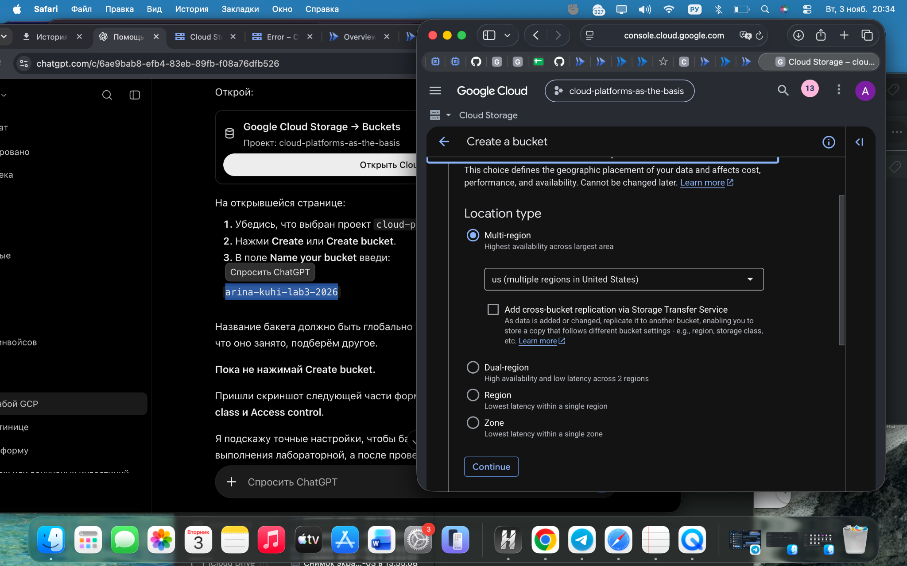
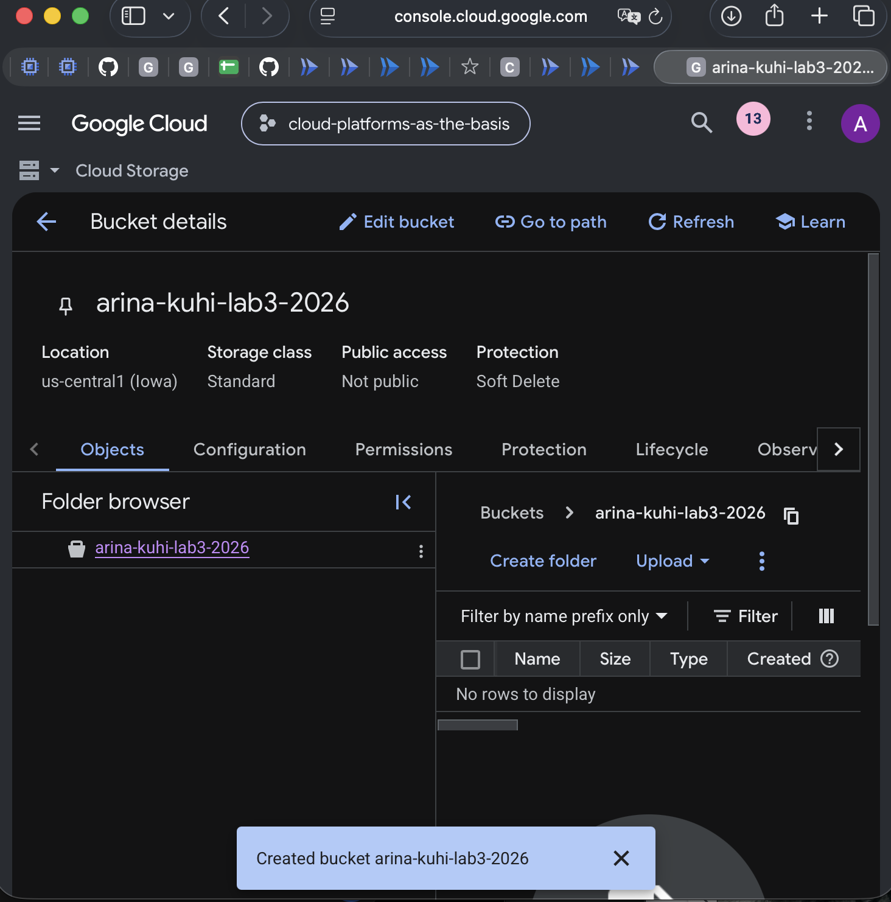
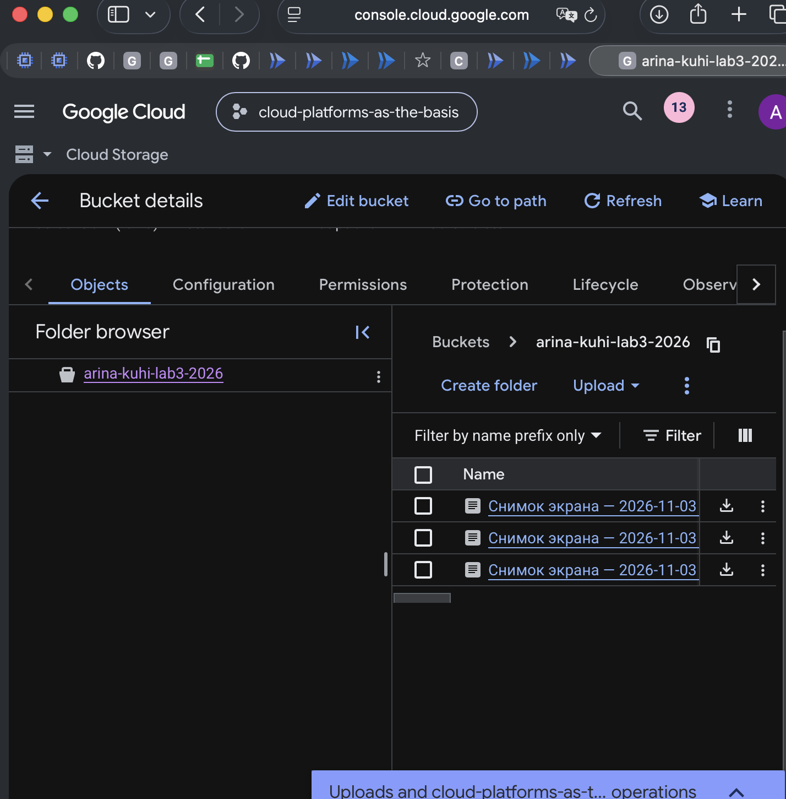
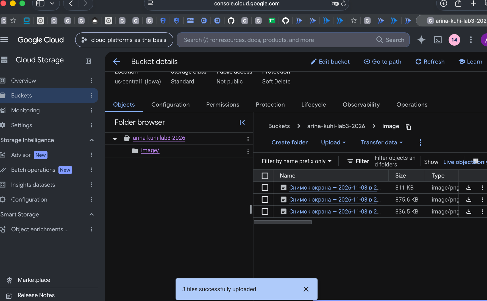
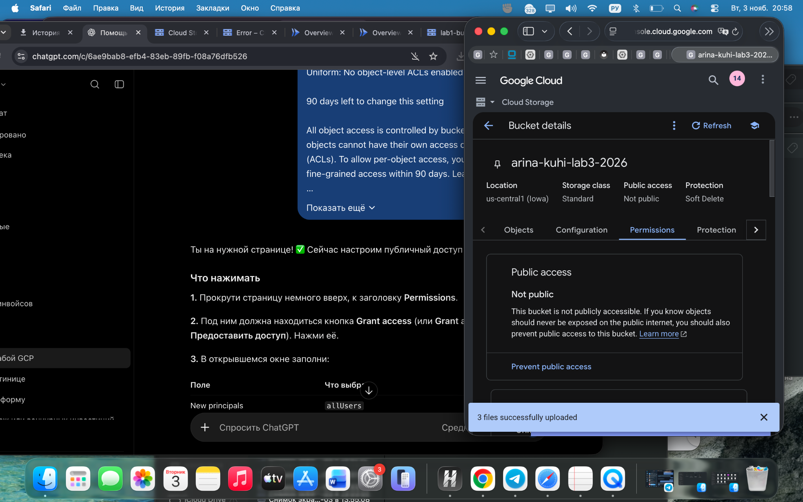
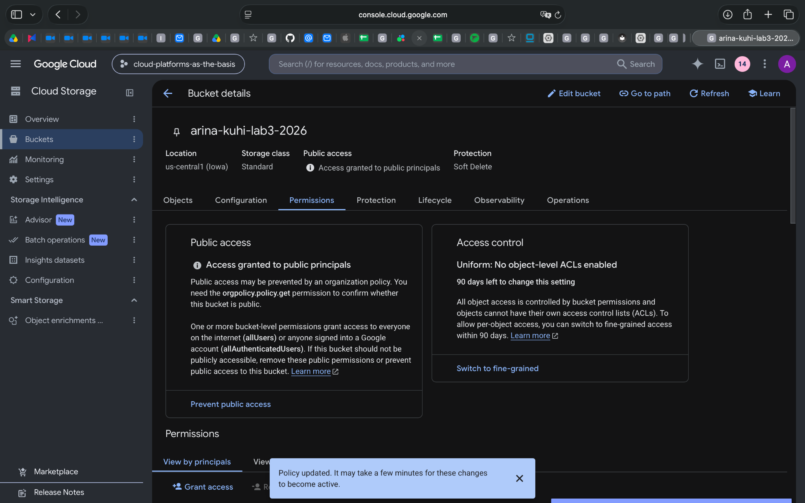
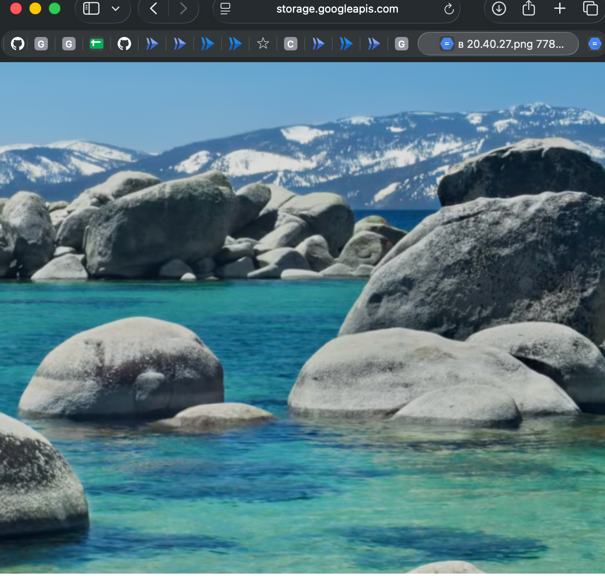
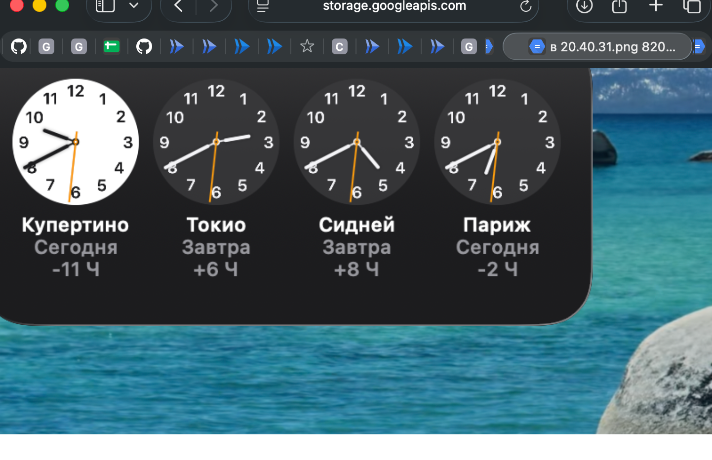

# Лабораторная работа №3. Исследование Cloud Storage

**Университет:** Университет ИТМО  
**Дисциплина:** Облачные платформы как основа технологического предпринимательства  
**Студент:** Кухи Арина  
**Группа:** U4225  
**Дата выполнения:** 03.11.2026  
**Дата защиты:** не защищена

## 1. Цель работы

Изучить возможности Google Cloud Storage: создание бакета, загрузку объектов, организацию файлов, управление доступом через IAM и публикацию изображений по ссылкам.

## 2. Ход работы

### 2.1. Создание бакета

В проекте Google Cloud `cloud-platforms-as-the-basis` был создан бакет со следующими параметрами:

| Параметр | Значение |
|---|---|
| Имя бакета | `arina-kuhi-lab3-2026` |
| Тип расположения | Region |
| Регион | `us-central1` (Iowa) |
| Класс хранения | Standard |
| Управление доступом | Uniform |
| Public access prevention | Не включено |
| Защита | Soft Delete |

Настройки расположения:



Созданный бакет:



### 2.2. Загрузка файлов

В разделе **Objects** через **Upload → Upload files** в корень бакета были загружены три PNG-изображения.



### 2.3. Создание папки

В бакете была создана папка `image/`. Поскольку операция **Move** не использовалась, изображения были удалены из корня и повторно загружены непосредственно в папку `image/`.

Итоговая структура:

```text
arina-kuhi-lab3-2026/
└── image/
    ├── Снимок экрана — 2026-11-03 в 20.40.24.png
    ├── Снимок экрана — 2026-11-03 в 20.40.27.png
    └── Снимок экрана — 2026-11-03 в 20.40.31.png
```



### 2.4. Проверка исходных разрешений

Изначально в настройках бакета отображался статус **Not public**. Использовался режим **Uniform bucket-level access**, при котором доступ к объектам управляется через IAM-политику бакета, а отдельные ACL объектов отключены.



### 2.5. Настройка публичного доступа

Во вкладке **Permissions** для принципала `allUsers` была назначена роль **Storage Object Viewer**. После сохранения изменений Google Cloud показал статус **Access granted to public principals**.

| Параметр | Значение |
|---|---|
| Principal | `allUsers` |
| Role | `Storage Object Viewer` |
| Resource | `arina-kuhi-lab3-2026` |

При Uniform bucket-level access эта роль разрешает публичное чтение объектов **всего бакета**, а не только папки `image/`.



### 2.6. Проверка изображений по публичным ссылкам

Для объектов были получены URL на домене `storage.googleapis.com`. Во время выполнения работы изображения успешно открывались в браузере.





Третье изображение также было проверено. Пример структуры URL:

```text
https://storage.googleapis.com/arina-kuhi-lab3-2026/image/<имя_файла>
```

### 2.7. Очистка ресурсов

После завершения проверки публичных ссылок созданный бакет `arina-kuhi-lab3-2026` был удалён. Публичные ссылки приведены в отчёте как часть эксперимента и после удаления бакета не считаются действующими.

## 3. Результаты

| Действие | Результат |
|---|---|
| Создание бакета в `us-central1` | Выполнено |
| Загрузка трёх PNG-файлов | Выполнено |
| Создание папки `image/` | Выполнено |
| Повторная загрузка файлов в папку | Выполнено |
| Назначение `allUsers` роли `Storage Object Viewer` | Выполнено |
| Проверка публичных ссылок | Выполнено |
| Удаление учебного бакета | Выполнено |

## 4. Вывод

В ходе лабораторной работы изучены основные операции с объектным хранилищем Google Cloud Storage: создание бакета, выбор региона и класса хранения, загрузка и организация объектов, а также настройка доступа через IAM.

Проверка показала, что роль `Storage Object Viewer`, назначенная `allUsers`, разрешает публичное чтение объектов бакета. При использовании Uniform bucket-level access права задаются на уровне бакета. После эксперимента временный ресурс был удалён.

**Цель работы достигнута.**

## 5. Источники

1. [Задание лабораторной №3 — Университет ИТМО](https://ex-itmo-ict-faculty.github.io/cloud-platforms-as-the-basis-of-technology-entrepreneurship/education/labs2023-2024/lab3/lab3/)
2. [Документация Google Cloud Storage](https://cloud.google.com/storage/docs)
3. [Документация Google Cloud IAM](https://cloud.google.com/iam/docs)
