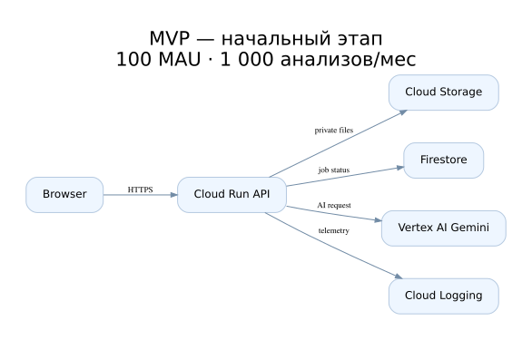
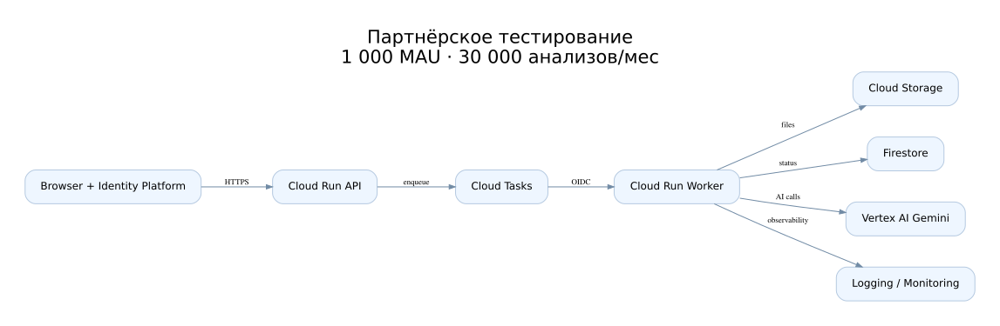
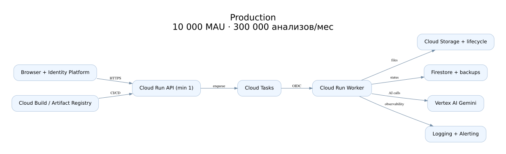

# Лабораторная работа №4. Разработка инфраструктуры MVP AI-приложения

**University:** ITMO University  
**Faculty:** FICT  
**Course:** Cloud platforms as the basis of technology entrepreneurship  
**Year:** 2026  
**Group:** U4225  
**Author:** Кухи Арина  
**Lab:** Lab4  
**Date of create:** 03.11.2026  
**Date of finished:** не защищена

## Цель и результат

Спроектировать архитектуру AI Document Assistant для MVP, тестирования партнёрами и промышленной эксплуатации, обосновать выбор инфраструктуры и рассчитать модель ежемесячных расходов. В этой лабораторной **ресурсы GCP не развёртываются**: все нагрузки и бюджеты являются проектными допущениями, а не измерениями и не выставленными счетами.

## 1. Назначение приложения и ограничения

AI Document Assistant принимает текстовые PDF (с выделяемым текстом), TXT и Markdown, формирует краткое резюме и отвечает на вопросы по загруженному документу с использованием Vertex AI. Для MVP ограничение размера файла — 1 MiB; сканы, OCR, голосовые данные и обучение собственной модели **не поддерживаются**. Документы хранятся 30 дней, срок soft delete — 7 дней. Проверка качества ответов обязательна: генерация не гарантирует полноту и достоверность.

| Допущение | MVP | Партнёры | Production |
|---|---:|---:|---:|
| Активных пользователей за месяц | 100 | 1 000 | 10 000 |
| Успешных AI-анализов в месяц | 1 000 | 30 000 | 300 000 |
| Пик новых заданий, в секунду | 0,1 | 2 | 12 |
| Средняя входная последовательность, токенов | 3 000 | 3 000 | 3 000 |
| Средний оплачиваемый ответ, токенов | 400 | 400 | 400 |
| Среднее время работы Worker | 8 с | 8 с | 8 с |
| Коэффициент повторных попыток | 1,05 | 1,05 | 1,05 |
| Средний размер документа с результатом | 1,1 MiB | 1,1 MiB | 1,1 MiB |

Расчётный месяц — 30 дней. Для оценки пиков отдельно используем коэффициент повторных попыток; средний поток за месяц не подменяет peak capacity. Средний размер объекта 1,1 MiB — условная оценка, максимальный документ ограничен 1 MiB, остальное приходится на результат и метаданные. Полный PDF анализируется после извлечения текста; длинные документы, превышающие лимит токенов, отклоняются с предложением сократить текст.

## 2. Схемы инфраструктуры

Редактируемая схема draw.io: [ai-document-assistant.drawio](diagrams/ai-document-assistant.drawio). Она содержит три вкладки; SVG доступны для просмотра прямо на GitHub.

### 2.1. MVP



На старте браузер общается с API Cloud Run. Сервис проверяет ограничения файлов, записывает документ в приватный Cloud Storage, фиксирует статус в Firestore и вызывает Vertex AI. Для учебного MVP допускается синхронное ожидание AI при ограничении числа одновременных запросов; API должен иметь таймаут, не допуская бесконечного ожидания. Обработка PDF ограничена текстовым слоем, извлечение текста выполняется внутри API до вызова модели. Cloud Run использует min instances=0, max instances=3, request-based billing, 1 vCPU и 512 MiB RAM.

### 2.2. Тестирование партнёрами



Обработка вынесена в отдельный Cloud Run Worker (1 vCPU, 1 GiB) и Cloud Tasks. API принимает запрос, сохраняет документ, создаёт задание в Firestore и ставит задачу в очередь. Worker вызывается по OIDC, работает с приватным бакетом, обращается к Vertex AI и сохраняет ответ. API может отдавать `202 Accepted` и статус. Добавляются Identity Platform, журналирование ошибок, метрики очереди, отдельное staging-окружение и квоты партнёров. Предполагаемые пределы: API max=20, Worker max=40, concurrency Worker=1.

### 2.3. Production



Основной API с минимум одним экземпляром уменьшает холодный старт; Worker продолжает масштабироваться до нуля. Добавляются резервное копирование Firestore, контроль задержек, сборка и версионирование контейнеров, политики хранения, алерты и разграничение сервисных аккаунтов. При peak=12 заданий/с и времени 8 с нужно примерно `ceil(12 × 1,05 × 8) = 101` параллельный Worker; в проекте задаётся max=140, но реальная пропускная способность Vertex AI, квоты Cloud Run и Cloud Tasks должны быть проверены нагрузочным испытанием до внедрения. Это **региональная**, а не мультирегиональная архитектура; полный отказ региона не покрыт.

## 3. Потоки данных и безопасность

1. Клиент проходит аутентификацию (на MVP возможен ограниченный доступ по allowlist).
2. API проверяет тип, размер, владельца документа и лимиты пользователя.
3. Файлы сохраняются в **приватный** Cloud Storage, без `allUsers`. Публичные ссылки на исходные документы не выдаются.
4. Метаданные задания записываются в Firestore. Начиная с партнёрского этапа Cloud Tasks передаёт задание Worker с OIDC.
5. Worker выполняет AI-запрос к Gemini через Vertex AI и сохраняет результат; API отдаёт его только владельцу документа.
6. Retention/lifecycle 30 дней и soft delete 7 дней ограничивают хранение; логи не содержат текстов документов, JWT и секретов.

IAM следует принципу минимальных полномочий; API и Worker используют отдельные сервисные аккаунты и Application Default Credentials. Выбор синхронной обработки на MVP дешевле операционно, но требует миграции на очередь при росте нагрузки; эта миграция прямо заложена в план второй стадии.

## 4. Экономическая модель

### 4.1. Тарифы и допущения

Оценка USD/месяц, без вычитания бесплатных квот, налогов, скидок и промокредитов. Для региональных компонентов — `us-central1`; AI — по стандартным тарифам, применимость endpoint и региональных требований проверяется отдельно. Использованы опубликованные цены: Gemini 2.5 Flash-Lite (standard): **$0.10 за 1 млн входных токенов, $0.40 за 1 млн выходных**; Cloud Run: **$0.000024/vCPU·с, $0.0000025/GiB·с, $0.40/млн запросов**; Cloud Storage Standard приблизительно **$0.020/GiB·мес**. Прочие ориентиры в расчёте — Firestore $0.03/100 тыс. чтений, $0.09/100 тыс. записей; Cloud Tasks $0.40/млн операций; logging $0.50/GiB; egress условно $0.12/GiB. Ставки могут измениться, а тарифы и применимые категории сетевого трафика различаются. Сборки и образы — отдельные модельные суммы.

Ссылки на официальные прайс-листы: [Vertex AI](https://cloud.google.com/gemini-enterprise-agent-platform/generative-ai/pricing), [Cloud Run](https://cloud.google.com/run/pricing), [Cloud Storage](https://cloud.google.com/storage/pricing), [Firestore](https://cloud.google.com/firestore/pricing), [Cloud Tasks](https://cloud.google.com/tasks/pricing), [Logging](https://cloud.google.com/stackdriver/pricing), [Network](https://cloud.google.com/vpc/network-pricing). Для учебной модели некоторые малые статьи оценены упрощённо — это не точный расчёт Google Cloud Pricing Calculator.

### 4.2. Методика

Пусть `N` — успешные операции, `U` — активные пользователи, `M = 1.05 × N` — оплачиваемые попытки. Тогда:

```text
AI = M × (3000 × 0.10 + 400 × 0.40) / 1 000 000
API = (10N × 0.15) × (0.000024 + 0.5 × 0.0000025) + (10N × 0.40 / 1 000 000)
Worker = (M × 8) × (0.000024 + 1 × 0.0000025) + (M × 0.40 / 1 000 000)
Tasks = (N + M) × 0.40 / 1 000 000
Storage_GiB = N × 1.1 MiB × (30+7)/30 / 1024
Total = сумма вычисленных статей, затем резерв 20%
```

В MVP отдельного Worker и Cloud Tasks нет: стоимость синхронной AI-обработки уже учтена в времени API, которое в настоящей оценке надо увеличить на 8 секунд для каждого анализа. Чтобы исключить недооценку, в следующей таблице Worker-позиция **используется как вычислительный эквивалент синхронной AI-обработки MVP**, а не как фактически развёрнутый отдельный сервис. Аналогично плата Cloud Tasks в MVP является консервативной модельной оценкой, хотя очередь там ещё отсутствует. При реальном расчёте API busy time на MVP необходимо заменить на полное время синхронной обработки; текущий расчёт лишь предварительный бюджет по эквивалентным compute-секундам.

### 4.3. Сравнение расходов

| Статья, USD/месяц | MVP | Партнёры | Production |
|---|---:|---:|---:|
| Vertex AI Gemini 2.5 Flash-Lite | 0.48 | 14.49 | 144.90 |
| Cloud Run API | 0.04 | 1.26 | 12.56 |
| Cloud Run Worker | 0.22 | 6.69 | 66.91 |
| Cloud Tasks | 0.00 | 0.02 | 0.25 |
| Cloud Storage | 0.04 | 1.14 | 11.40 |
| Firestore | 0.01 | 0.15 | 1.52 |
| Исходящий трафик | 0.11 | 1.29 | 12.89 |
| Cloud Logging | 0.01 | 0.32 | 3.16 |
| Cloud Build | 0.60 | 3.00 | 12.00 |
| Artifact Registry | 0.10 | 0.30 | 1.00 |
| Тёплый экземпляр API (prod) | 0.00 | 0.00 | 9.72 |
| Дополнительное staging | 0.00 | 2.54 | 25.36 |
| **Всего облако** | **1.61** | **31.20** | **301.67** |
| **Бюджет с резервом 20%** | **1.93** | **37.43** | **362.01** |

**Важно:** при переходе к продакшену качество распознавания и расход токенов изменят бюджет. Наиболее чувствительны входной объём текста, объём ответа, частота повторов и время выполнения Worker. При двукратном увеличении входных токенов **стоимость AI входных токенов удваивается**, но не весь бюджет целиком. В модели не учтены платные Document AI OCR, LLM embeddings, vector DB, собственный домен, лицензии, ручная разработка и коммерческая поддержка, потому что они не входят в заявленный MVP.

## 5. Обоснование решений и риски

| Сервис | Причина выбора и альтернативы |
|---|---|
| Cloud Run | Контейнерный API без администрирования виртуальных машин, scale-to-zero; для постоянной высокой нагрузки позже следует сравнить GKE и VM |
| Cloud Storage | Приватное объектное хранение исходных документов и результатов, lifecycle и ограниченный доступ |
| Firestore | Небольшие документы с метаданными и статусами, нет постоянно работающего SQL-сервера |
| Vertex AI Gemini | Оплата токенов вместо выделенной GPU-машины; качество нужно проверить на тестовой выборке |
| Cloud Tasks | Очередь и retries начиная с партнёрского этапа, защита AI от всплесков обращений |
| Cloud Logging/Monitoring | Алерты на частоту ошибок, задержки, долю неуспешных заданий и расход API |
| Cloud Build/Artifact Registry | Повторяемые сборки и rollback контейнеров |

В production важно учитывать, что Cloud Tasks обеспечивает доставку **at least once**, а не exactly once. Для исключения повторной публикации результата используется idempotency key, состояние задания и ограниченное число попыток. Однако повторный вызов AI может повлечь повторные расходы: коэффициент 1,05 лишь оценивает это явление. Для отказоустойчивости нужны восстановление данных Firestore, тесты rollback, контроль расходов и ограничения доступа. Предложенная схема не гарантирует бесперебойность при отказе всего региона.

## 6. Вывод

Спроектированы три варианта развития AI Document Assistant: начальный MVP с небольшим числом пользователей, партнёрский этап с асинхронной обработкой и промышленная эксплуатация с мониторингом, резервным копированием и контролем масштабирования. Схемы приложены в редактируемом формате draw.io и SVG. Расходы рассчитаны по предположениям о трафике и токенах; результаты являются прогнозом. Cloud-ресурсы в рамках четвёртой лабораторной не создавались.

## 7. Использованные источники

- [Задание лабораторной №4 ИТМО](https://ex-itmo-ict-faculty.github.io/cloud-platforms-as-the-basis-of-technology-entrepreneurship/education/labs2023-2024/lab4/lab4/)
- [Cloud Run Pricing](https://cloud.google.com/run/pricing)
- [Vertex AI Pricing](https://cloud.google.com/gemini-enterprise-agent-platform/generative-ai/pricing)
- [Cloud Storage Pricing](https://cloud.google.com/storage/pricing)
- [Cloud Firestore Pricing](https://cloud.google.com/firestore/pricing)
